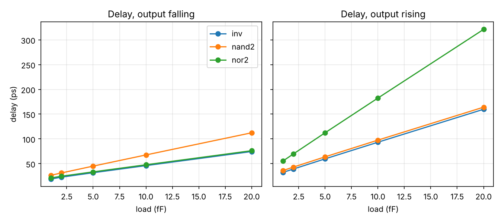

# From transistor to chip: a MAC neuron on SKY130

This project takes the multiply-accumulate neuron from my
[fpga-mac-neuron](https://github.com/HannaBeshoy/fpga-mac-neuron) repository
and moves it from an FPGA towards a real chip, using the open SkyWater 130 nm
process (SKY130). It starts at the lowest level, single transistors, and works
up to a placed and routed layout.

I do it in stages. Each stage is finished and committed before the next one
starts, so the history of the repository shows the order of the work.

## Stages

| Stage | What | Tools | Status |
|---|---|---|---|
| 1 | Inverter, NAND2 and NOR2 at transistor level: transfer curve, noise margins, delay against load, switching energy, three process corners | ngspice, Python | done, [results](results/cells.md), [notes](docs/stage1_notes.md) |
| 2 | Compare my cell numbers with the timing data of the foundry cell library | Python | not started |
| 3 | Synthesise the neuron to SKY130 standard cells: cell count, area, timing estimate | Yosys | not started |
| 4 | Place and route, design-rule and layout-versus-schematic checks, timing after layout | OpenLane | not started |
| 5 | Optional: prepare the design for a Tiny Tapeout shuttle | Tiny Tapeout flow | not started |

## Stage 1 results in short

| Typical corner, 1.8 V, 25 °C | Inverter | NAND2 | NOR2 |
|---|---|---|---|
| Switching threshold | 0.79 V | 0.80 V | 0.78 V |
| Noise margin low / high | 0.69 / 0.93 V | 0.69 / 0.92 V | 0.68 / 0.94 V |
| Fall / rise delay with 5 fF | 32 / 60 ps | 45 / 64 ps | 33 / 112 ps |
| Pull-down / pull-up resistance | 4.2 / 9.7 kΩ | 6.5 / 9.8 kΩ | 4.2 / 20.3 kΩ |
| Energy per cycle with 5 fF | 21.3 fJ | 23.3 fJ | 23.1 fJ |



The n-channel side is about twice as strong as the p-channel side, so the
threshold sits below half the supply and NOR2, which stacks the weak
p-channel devices, is the slowest cell. The slow corner is about 1.7 times
slower than typical and the fast corner about 1.4 times faster. All numbers
for all corners are in [results/cells.md](results/cells.md), and the method
and its limits are in [docs/stage1_notes.md](docs/stage1_notes.md).

34 automatic tests check the cells (`python3 -m pytest tests`, about two
minutes) and run on every push.

## Stage 1 plan

Questions I want to answer with simulation:

1. At which input voltage does each cell switch, and how large are the noise
   margins at 1.8 V?
2. How does the delay grow with the load capacitance, and what output
   resistance does that give?
3. How much energy does one output transition cost?
4. How much do the slow and fast process corners change these numbers?

Conditions:

| Corner | Transistors | Supply | Temperature |
|---|---|---|---|
| tt | typical | 1.80 V | 25 °C |
| ss | slow | 1.60 V | 100 °C |
| ff | fast | 1.95 V | -40 °C |

The cells are in `cells/cells.spice`. They use the 1.8 V transistors of the
process at the minimum channel length of 0.15 µm, with an n-channel width of
0.65 µm and a p-channel width of 1.00 µm. Source and drain areas are estimates
made before layout, so the absolute delays are a first approximation.

## Folders

| Folder | Content |
|---|---|
| `cells/` | transistor-level netlists of the cells |
| `sim/` | model setup for each corner and simulation decks |
| `tools/` | scripts: fetch the device models, run the measurements |
| `tests/` | automatic checks on the cells |
| `results/` | measured numbers and plots |
| `docs/` | notes on method and theory |

## How to run

Needs `git`, `ngspice` (tested with version 42) and Python 3 with numpy
and pytest.

```sh
tools/get_pdk.sh                    # fetches the SKY130 device models, about 30 MB
cd sim && ngspice -b inv_dc.cir     # prints the switching threshold of the inverter
cd .. && python3 -m pytest tests    # 34 checks, about two minutes
python3 tools/report.py             # rebuilds results/ (needs matplotlib)
```

The device models come from the
[SkyWater open PDK](https://github.com/google/skywater-pdk-libs-sky130_fd_pr)
(Apache 2.0 licence) and are not copied into this repository.

## Licence

MIT, see `LICENSE`.
