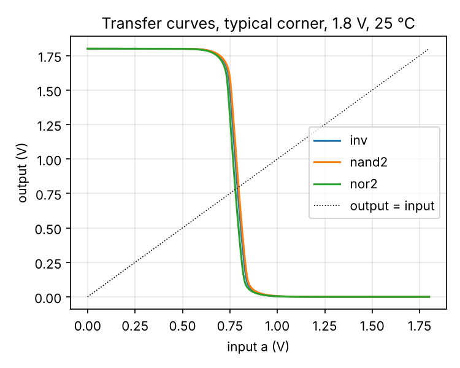
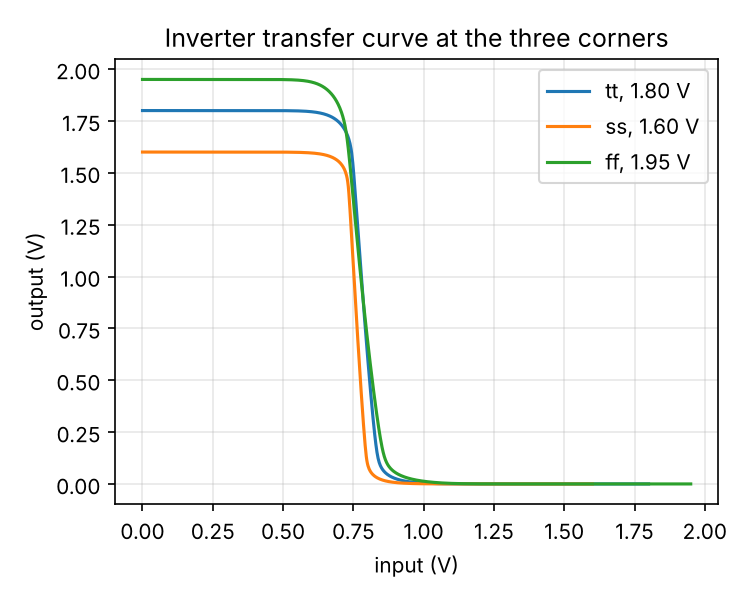
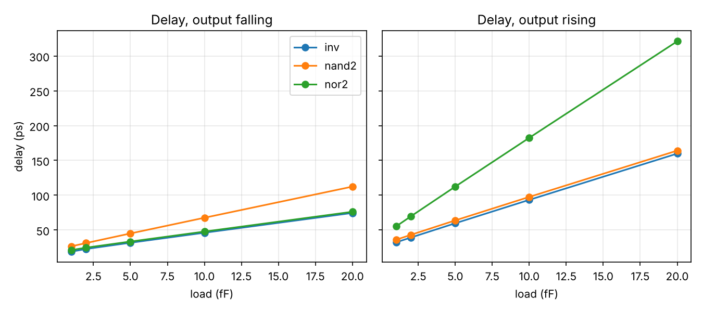

# Stage 1 results: three cells at transistor level

Written by `tools/report.py`. Input edge 50 ps, input a switching, the other input held at the level that lets a control the output.

## Transfer curve

| Cell | Corner | Supply (V) | Threshold (V) | V_IL (V) | V_IH (V) | NM_L (V) | NM_H (V) | Peak gain |
|---|---|---|---|---|---|---|---|---|
| inv | tt | 1.80 | 0.790 | 0.688 | 0.870 | 0.688 | 0.930 | 18.6 |
| inv | ss | 1.60 | 0.762 | 0.692 | 0.826 | 0.692 | 0.774 | 22.9 |
| inv | ff | 1.95 | 0.792 | 0.652 | 0.894 | 0.652 | 1.056 | 14.4 |
| nand2 | tt | 1.80 | 0.796 | 0.694 | 0.876 | 0.694 | 0.924 | 18.4 |
| nand2 | ss | 1.60 | 0.766 | 0.696 | 0.830 | 0.696 | 0.770 | 22.8 |
| nand2 | ff | 1.95 | 0.802 | 0.658 | 0.904 | 0.658 | 1.046 | 14.2 |
| nor2 | tt | 1.80 | 0.778 | 0.678 | 0.858 | 0.678 | 0.942 | 19.4 |
| nor2 | ss | 1.60 | 0.758 | 0.686 | 0.820 | 0.686 | 0.780 | 23.2 |
| nor2 | ff | 1.95 | 0.772 | 0.634 | 0.870 | 0.634 | 1.080 | 16.0 |

## Delay and energy with a 5 fF load

| Cell | Corner | Fall delay (ps) | Rise delay (ps) | Fall time (ps) | Rise time (ps) | Energy per cycle (fJ) | Load part C·Vdd² (fJ) |
|---|---|---|---|---|---|---|---|
| inv | tt | 31.7 | 59.7 | 22.8 | 56.0 | 21.3 | 16.2 |
| inv | ss | 52.9 | 93.9 | 42.9 | 94.2 | 17.4 | 12.8 |
| inv | ff | 22.4 | 45.2 | 18.3 | 40.5 | 24.2 | 19.0 |
| nand2 | tt | 45.0 | 63.8 | 39.2 | 60.9 | 23.3 | 16.2 |
| nand2 | ss | 93.2 | 101.2 | 91.9 | 103.0 | 19.1 | 12.8 |
| nand2 | ff | 28.6 | 47.9 | 24.6 | 43.8 | 26.3 | 19.0 |
| nor2 | tt | 33.4 | 112.4 | 24.3 | 126.3 | 23.1 | 16.2 |
| nor2 | ss | 56.1 | 194.6 | 46.5 | 220.6 | 18.9 | 12.8 |
| nor2 | ff | 23.6 | 77.8 | 18.9 | 86.6 | 26.3 | 19.0 |

## Delay against load

Straight-line fit `delay = t0 + 0.69 · R · C` over loads of 1, 2, 5, 10 and 20 fF.

| Cell | Corner | Fall t0 (ps) | Fall R (kΩ) | Rise t0 (ps) | Rise R (kΩ) |
|---|---|---|---|---|---|
| inv | tt | 16.7 | 4.21 | 25.9 | 9.72 |
| inv | ss | 26.1 | 7.67 | 37.3 | 16.21 |
| inv | ff | 10.2 | 3.13 | 20.8 | 7.06 |
| nand2 | tt | 22.3 | 6.54 | 29.7 | 9.76 |
| nand2 | ss | 41.8 | 14.77 | 44.6 | 16.20 |
| nand2 | ff | 13.8 | 4.12 | 23.2 | 7.11 |
| nor2 | tt | 18.7 | 4.18 | 41.8 | 20.27 |
| nor2 | ss | 29.4 | 7.66 | 72.5 | 35.08 |
| nor2 | ff | 11.9 | 3.07 | 29.5 | 13.95 |

